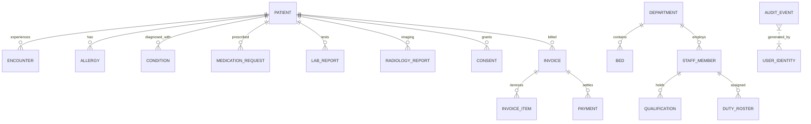

# KratosSecure: Hospital Relational & Object Data Model

## 1. Relational Entity Schema

The database model is built on SQLAlchemy 2.0 with strict relational integrity, foreign key cascading, and ISO/HL7 standard terminology mappings.

---

## 2. Table Specifications

### Clinical Entities

#### `patients`
- `id` (PK, Integer, Auto)
- `mrn` (String 32, Unique, Indexed) - e.g. `MRN-20260001`
- `first_name` / `last_name` (String 64)
- `dob` (String 16, YYYY-MM-DD)
- `gender` (String 16)
- `phone` / `email` / `address` (Contact details)
- `blood_group` (String 8) - e.g. `O+`, `A-`
- `emergency_contact` (String 128)
- `is_active` (Boolean)
- `created_at` / `updated_at` (DateTime)

#### `encounters`
- `id` (PK, Integer)
- `encounter_number` (String 32, Unique, Indexed) - e.g. `ENC-2026-8001`
- `patient_id` (FK -> patients.id)
- `department_id` (FK -> departments.id)
- `attending_doctor_id` (FK -> staff_members.id)
- `encounter_type` (`emergency`, `inpatient`, `outpatient`, `icu`)
- `status` (`planned`, `arrived`, `in-progress`, `discharged`, `cancelled`)
- `chief_complaint` (Text)
- `admission_date` / `discharge_date` (DateTime)
- `bed_id` (FK -> beds.id, Nullable)
- `triage_acuity` (Integer: 1 to 5)

#### `lab_reports`
- `id` (PK, Integer)
- `report_number` (String 32, Unique) - e.g. `LAB-2026-90001`
- `patient_id` (FK -> patients.id)
- `test_code` (String 32) - LOINC Code (e.g. `58410-2` for CBC)
- `test_name` (String 128)
- `category` (`hematology`, `biochemistry`, `microbiology`, `pathology`)
- `result_data` (JSON Object) - Itemized lab values, units, and reference ranges
- `interpretation` (`Normal`, `High`, `Low`, `Critical`)
- `collection_time` / `created_at` (DateTime)

#### `radiology_reports`
- `id` (PK, Integer)
- `accession_number` (String 32, Unique) - e.g. `RAD-2026-70001`
- `modality` (`CT`, `MRI`, `X-RAY`, `US`, `PET`)
- `study_name` (String 128)
- `findings` (Text)
- `impression` (Text)
- `urgent_flag` (Boolean)

---

### Infrastructure Entities

#### `departments` (15 entries)
- `id` (PK, Integer)
- `code` (String 32, Unique) - `EMERGENCY`, `ICU`, `IPD`, `LAB`, `BILLING`, etc.
- `name` (String 128)
- `building` (String 64) - `Building A`, `Building B`, `Building C`
- `floor` (String 16)
- `total_beds` (Integer)
- `status` (`operational`, `degraded`, `closed`, `emergency_mode`)
- `current_workload` (`low`, `normal`, `high`, `critical`)
- `wait_time_minutes` (Integer)

#### `beds` (Exactly 500 beds)
- `id` (PK, Integer)
- `bed_number` (String 32, Unique) - `IPD-3101-A`, `ICU-BED-01`, `ED-BAY-01`
- `department_id` (FK -> departments.id)
- `room_number` (String 32)
- `bed_type` (`standard`, `icu`, `emergency`, `isolation`)
- `is_occupied` (Boolean)
- `has_ventilator` (Boolean)
- `has_cardiac_monitor` (Boolean)
- `status` (`available`, `occupied`, `maintenance`, `cleaning`)

---

### Security & Tamper-Evident Ledger Entities

#### `audit_events`
- `id` (PK, Integer, Auto)
- `event_id` (String 64, Unique, Indexed)
- `timestamp` (DateTime)
- `actor_id` (String 64) - User or Agent ID
- `actor_role` (String 64)
- `action` (`READ`, `CREATE`, `UPDATE`, `DELETE`, `DISPENSE`, `OVERRIDE`)
- `resource_type` (`Patient`, `LabReport`, `Invoice`, etc.)
- `resource_id` (String 64)
- `purpose_of_use` (`treatment`, `payment`, `operations`, `emergency_break_glass`)
- `decision` (`PERMIT`, `DENY`, `TRAPPED`)
- `previous_hash` (String 64) - SHA-256 of preceding block
- `entry_hash` (String 64, Unique, Indexed) - Cryptographic block hash

#### `canary_secrets`
- `id` (PK, Integer)
- `secret_key` (String 64, Unique) - e.g. `CANARY_KEY_EHR_DB_ADMIN`
- `secret_name` (String 128)
- `category` (`DB_ADMIN`, `RESEARCH_BUCKET`, `FINANCE_OVERRIDE`, `PATIENT_EXPORT_TOKEN`)
- `synthetic_value` (String 256)
- `is_tripped` (Boolean, Default False)
- `tripped_count` (Integer)
- `last_tripped_at` (DateTime)
- `last_tripped_by` (String 128)
